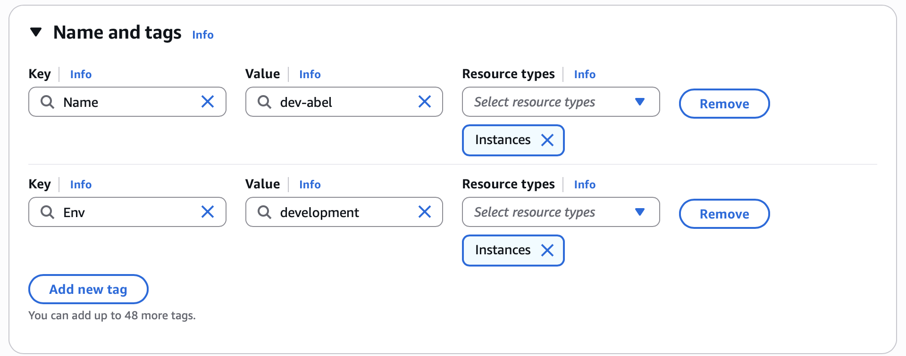
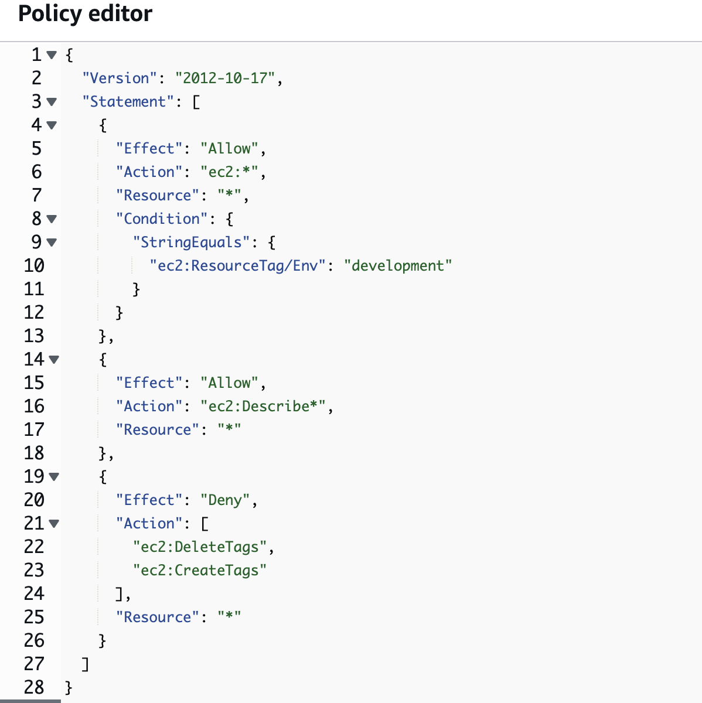
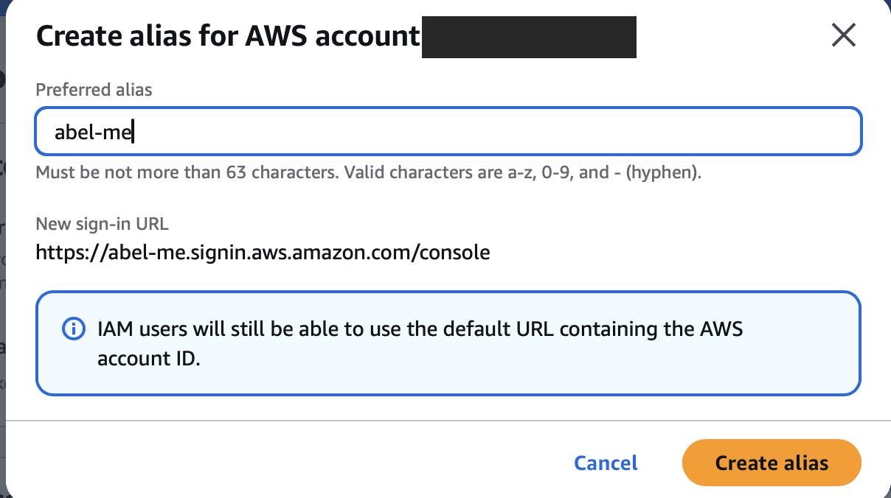
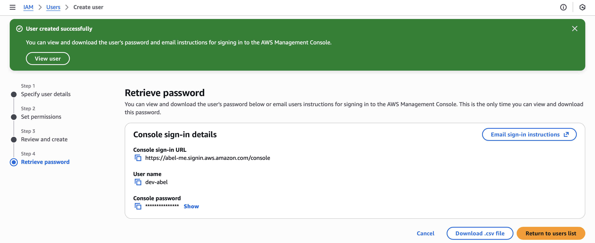
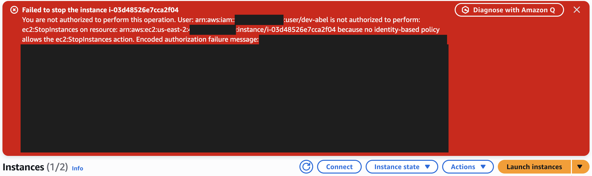
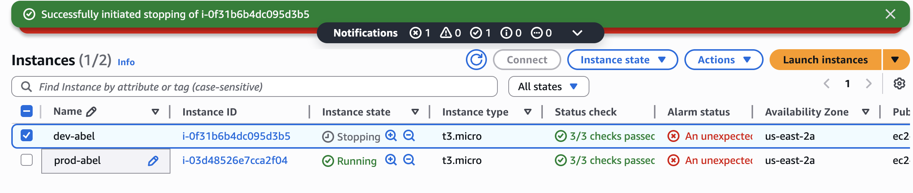
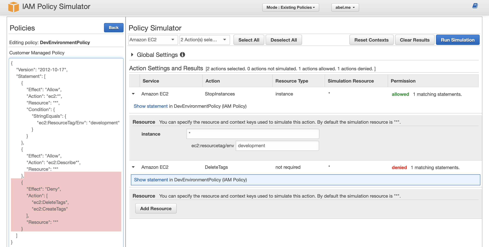

# Cloud Security with AWS IAM

**Author:** Abel Mesfin

## Project Overview

In this project, I will demonstrate how AWS IAM services can be used to control authentication and authorization permissions on an AWS account. I'm doing this project to learn the foundations of cloud security.

## Tools and Concepts

I used the Amazon EC2 and AWS IAM services. Some of the key concepts I learned include IAM users and groups, policies, and account aliases. In addition to launching my first EC2 instance, I logged in as another user and applied resource tags. I also used the policy simulator to better understand how JSON-based IAM policies work.

**Services:** Amazon EC2 · AWS IAM
**Concepts:** IAM Users & Groups · IAM Policies (JSON) · Resource Tags · Account Aliases · IAM Policy Simulator

---

## 1. Tags

### What I did in this step
In this step, I will launch two EC2 instances to increase computing power to prepare for an expected increase in users and website traffic.

### Understanding tags
Tags are organizational tools used to label resources. They can be helpful when grouping resources, applying policy, and allocating costs under a specific tag.

### My tag configuration
The tag I've used on my EC2 instances is called `Env`, standing for environment. The values I've assigned for my two instances are `production` and `development`.

| Instance | Tag Key | Tag Value |
|---|---|---|
| `prod-abel` | `Env` | `production` |
| `dev-abel` | `Env` | `development` |



---

## 2. IAM Policies

### What I did in this step
In this step, I will use IAM policies to control the access level of an onboarding "intern". The intern should be permitted access to the development environment (or instance). The intern should NOT be permitted to our production environment. Minimizing the chance for any accidental changes or potential untested code to be deployed.

### Understanding IAM policies
IAM Policies are rules that determine permissions and access for a given user, group, or role on resources within our environment. I will be using policies to control who has access to the production/development instance.

### The policy I set up
For this project, I've set up a policy using JSON.

### Policy effect
I've created a policy that allows the policy holder (the intern) to have full permissions to any instance with the `development` tag attached. The policy holder will also be able to view any instance, but will not have the ability to delete or create tags for any instance.

### Understanding Effect, Action, and Resource
In a JSON policy the **Effect** represents whether the policy is allowing/denying action. **Action** represents what the policy holder can or can not do. **Resource** refers to the literal AWS resources that the policy relates to.

### My JSON Policy
Full file: [`policies/DevEnvironmentPolicy.json`](policies/DevEnvironmentPolicy.json)

```json
{
  "Version": "2012-10-17",
  "Statement": [
    {
      "Effect": "Allow",
      "Action": "ec2:*",
      "Resource": "*",
      "Condition": {
        "StringEquals": {
          "ec2:ResourceTag/Env": "development"
        }
      }
    },
    {
      "Effect": "Allow",
      "Action": "ec2:Describe*",
      "Resource": "*"
    },
    {
      "Effect": "Deny",
      "Action": [
        "ec2:DeleteTags",
        "ec2:CreateTags"
      ],
      "Resource": "*"
    }
  ]
}
```



---

## 3. Account Alias

### What I did in this step
In this step, I will set up an alias for my AWS account's console login. This is to simplify the login process for users.

### Understanding account aliases
An account alias is essentially a nickname for my AWS account. I can refer to my account using this alias moving forward rather than a long account ID.

### Setting up my account alias
Creating an account alias took me about 15 seconds. Now, my new AWS console sign-in URL uses the alias I created.



---

## 4. IAM Users and User Groups

### What I did in this step
In this step, I will set up IAM users and IAM user groups. The IAM users can be seen as the login information for those who will be accessing my AWS account. The IAM user groups will essentially act as a folder that helps manage those with the same access levels.

### Understanding user groups
IAM user groups sort IAM users so that permissions can be applied to users on a group level.

### Attaching policies to user groups
I attached the policy I created to this user group, which means users who are created within this group will inherit the permissions attached to the `DevEnvironmentPolicy` IAM policy.

### Understanding IAM users
IAM users are people or entities that have access to and can log in to an AWS account.

---

## 5. Logging in as an IAM User

### Sharing sign-in details
The first way could be to email sign-in instructions to the user. The second way could be to download a `.csv` file with sign-in instructions inside.

### Observations from the IAM user dashboard
Once I logged in as my IAM user, I noticed I was denied access to panels on the main dashboard. This was because my IAM policy only permitted my intern access to the development EC2 instance, resulting in all access to anything else being denied.



---

## 6. Testing IAM Policies

### What I did in this step
In this step, I will log in to my AWS account as the onboarding intern in order to test access with production and development instances to ensure my policy has been implemented correctly.

### Testing policy actions
I tested my JSON IAM policy by attempting to stop both development and production instances using the intern's account.

### Stopping the production instance ❌
When I tried to stop the production instance I was met with an error. This was due to the fact that my production instance is tagged with a `production` label, meaning an intern lacks permission to alter anything in relation.



### Stopping the development instance ✅
Next, when I tried to stop the development instance it was successfully able to stop. This was because my policy `DevEnvironmentPolicy` has permitted the intern full access to the development instance.



---

## 7. IAM Policy Simulator

To extend my project, I'm going to test my permission policies in a more controlled and safe way. I'm doing this because attempting to stop instances and log in as users can be inefficient and disruptive.

### Understanding the IAM Policy Simulator
The IAM Policy Simulator is a tool that helps simulate actions to test permissions for a specific user, group, or role and action/s. It's useful for efficiently confirming whether or not your IAM policy is working as intended.

### How I used the simulator
I set up a simulation checking if our dev user group had the permissions to `DeleteTags` or `StopInstances`. The results were denied for both actions. I had to adjust the search to filter for EC2 instances tagged with `development`. After filtering the search I was able to see that permission was allowed as expected.



---

## Key Takeaways

**Least privilege matters.**
I gave the intern access to only the provisions that were necessary to them and denied access to everything else by default. This is what keeps new users from accidentally breaking production by having more access than needed.

**Tags can control access.**
I have learned that tags are more than simple organization tools. When adding a condition on the `Env` tag, my policy was applied automatically to all instances under the `development` tag. I was able to do this without having to individually list each instance I wanted it applied to.

**Protecting the tags is just as important.**
If the intern had the ability to change tags, they could re-tag the production instance as `development` and gain full access to it. This is why I denied `CreateTags` and `DeleteTags` in my policy. In IAM, an explicit Deny will always override an Allow.

**User groups make permissions easier to manage.**
Rather than attaching policies to each individual user, I attached the policy to the user group. This means any new user added to the group later on will automatically inherit the same access.

**Test policies before relying on them.**
Logging in as the intern and stopping instances proved my policy was working, but the Policy Simulator was a faster and safer way to confirm it. I also learned that the simulator needs the right details, such as the resource tag, otherwise the results can be misleading.

---

## Repository Structure

```
.
├── README.md
├── policies/
│   └── DevEnvironmentPolicy.json
└── screenshots/
```

*Account IDs have been redacted from screenshots.*
